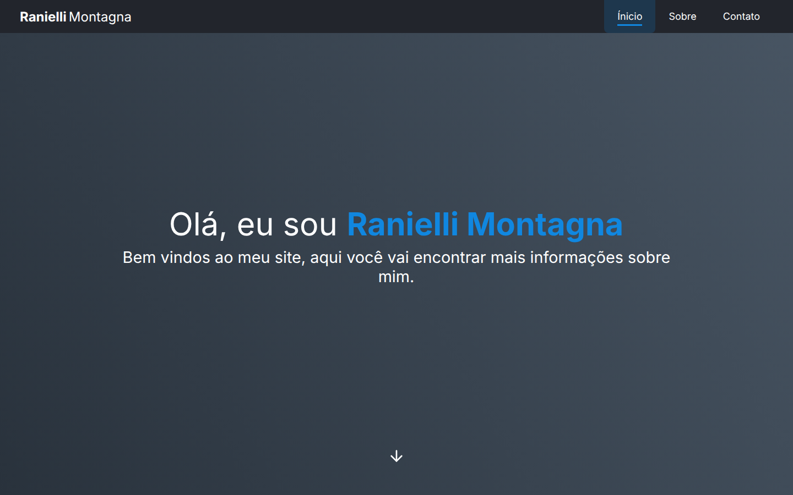
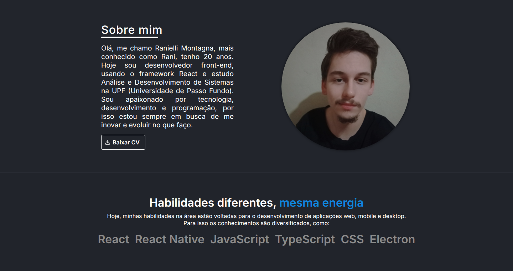
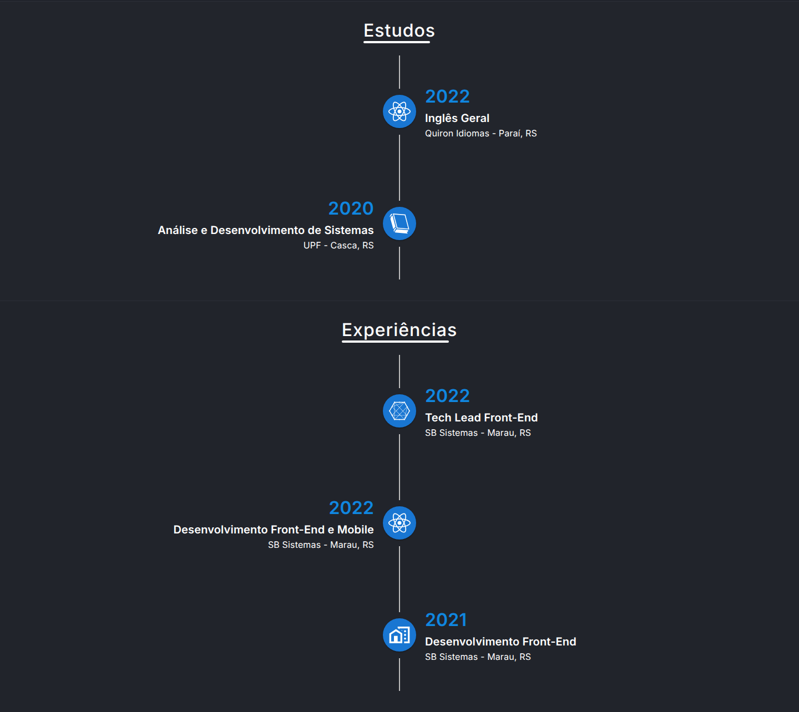
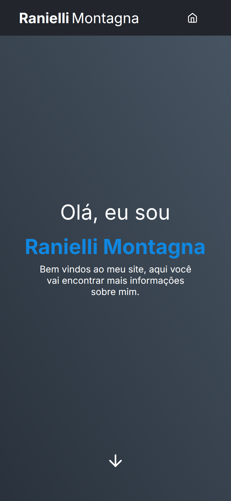
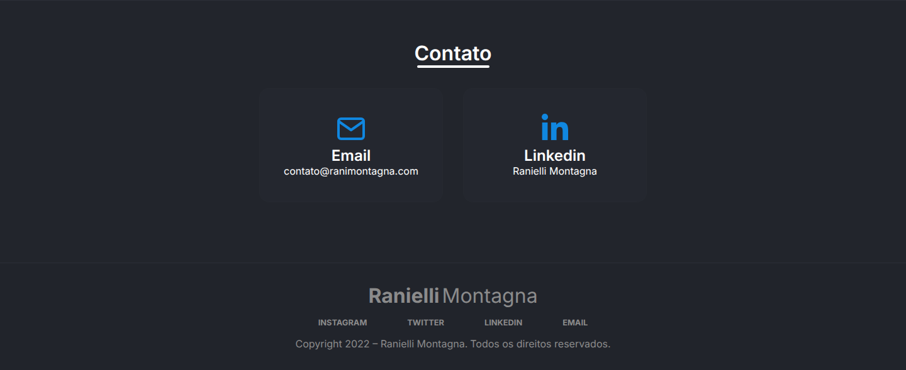

<div align="center">

# 2022.ranimontagna.com

**My personal site in 2022: a one-page React app with a typewriter hero, an about section with my CV, study and work timelines and contact cards. It was ranimontagna.com before [2024.ranimontagna.com](https://github.com/RanielliMontagna/2024.ranimontagna.com) replaced it.**


[**Live site**](https://2022.ranimontagna.com/) •
[Features](#features) •
[Screenshots](#screenshots) •
[Project layout](#project-layout) •
[Running locally](#running-locally) •
[History](#project-history)

</div>

> [!WARNING]
> **Discontinued.** This site is no longer maintained and this repository is archived as a portfolio reference. A copy is back online at [2022.ranimontagna.com](https://2022.ranimontagna.com/) on GitHub Pages. ranimontagna.com now serves my current site, and the next version of this one is at [2024.ranimontagna.com](https://2024.ranimontagna.com/).



## About

I built this site between April and August 2022, while I worked as a front-end developer at SB Sistemas and studied Systems Analysis and Development at UPF. It is a single page in Portuguese, made with Create React App and TypeScript, and it also works as an installable PWA. Its successor started in September 2022. This repository was called `rani-website` until October 2026.

## Features

- **Title bar** with links (Início, Sobre, Contato) that scroll smoothly with react-scroll and highlight the section on screen.
- **Hero** with three typewriter lines.
- **About me** with my photo and a "Baixar CV" button for `public/curriculo.pdf`.
- **Skills**, then **studies** and **experience** as vertical timelines.
- **Contact** cards for e-mail and LinkedIn, and a footer with social links. A WhatsApp card with my number was removed in October 2026.
- Reveal animations with AOS.
- **PWA**: web manifest and a Workbox service worker that precaches the build.
- Sentry error tracking in production builds.

## Screenshots

Taken in October 2026 from a local production build. The styles ask for the Qanelas Soft font but never load it, so visitors saw their browser's default sans-serif; these screenshots use Inter.

<table>
  <tr>
    <td colspan="2"><p align="center"><sub>About me and skills</sub></p></td>
  </tr>
  <tr>
    <td width="65%"><p align="center"><sub>Studies and experience</sub></p></td>
    <td width="35%" align="center"><p align="center"><sub>On a phone</sub></p></td>
  </tr>
  <tr>
    <td colspan="2"><p align="center"><sub>Contact and footer</sub></p></td>
  </tr>
</table>

## Project layout

```text
public/                 # index.html with SEO and Open Graph tags, web manifest, icons and CV
src/
├── pages/Home/         # titleBar, intro, sobre, habilidades, estudos, experiencia, contato, footer
├── components/         # typography, button, divider, menu, modal, loading, typewriter, page header, layout
├── themes/             # colors, font sizes and global styles for styled-components
├── store/              # Redux Toolkit slice for the loading state and the saved theme
├── routes/             # React Router 6 routes
├── service-worker.js   # Workbox precaching and runtime caching
└── index.tsx           # Sentry setup and service worker registration
```

## Tech stack

| Area | Tools |
| --- | --- |
| UI | React 17, TypeScript, styled-components, styled-system, MUI 5, React Icons |
| Behavior | react-scroll, AOS, typewriter-effect, Redux Toolkit, React Router 6 |
| PWA and monitoring | Workbox, web manifest, Sentry |
| Build | Create React App 4 (react-scripts 4.0.3), Yarn 1 |

## Running locally

Last checked in October 2026. Create React App 4 needs Node.js 16: on Node.js 24 the build stops inside PostCSS with `ERR_PACKAGE_PATH_NOT_EXPORTED`, even with the legacy OpenSSL provider.

```bash
git clone https://github.com/RanielliMontagna/2022.ranimontagna.com.git
cd 2022.ranimontagna.com
nvm use 16    # or: fnm use 16
npx yarn@1 install --frozen-lockfile --ignore-engines

npx yarn@1 start   # http://localhost:3000
npx yarn@1 build
```

The GitHub Pages copy is built with `REACT_APP_ENV=development npx yarn@1 build`, which leaves Sentry off, and published from the `gh-pages` branch with a `CNAME` file.

There are no tests. Use Yarn: `bun.lockb` comes from a July 2022 experiment and still lists a dependency that is no longer on npm.

## Project history

- **April 2022**: project created with the home, about, skills, contact and experience sections, then colors adjusted for contrast.
- **May 2022**: CV download, smooth scrolling with the current section highlighted, accessibility labels, a robots meta tag and my photo.
- **June 2022**: installable PWA with a web manifest and a Workbox service worker.
- **July 2022**: reveal animations with AOS and a Bun lockfile.
- **August 2022**: new experience entry. Last commit on 13 August 2022.
- **September 2022**: the next version of the site, now 2024.ranimontagna.com, started.
- **October 2026**: the unused `rm-design-system` dependency, no longer on npm, was removed so the install works again; the WhatsApp card came out; the site went back online on GitHub Pages at 2022.ranimontagna.com; the repository was renamed from `rani-website` and archived.

## Author

Built by [Ranielli Montagna](https://github.com/RanielliMontagna) · [ranimontagna.com](https://ranimontagna.com)
